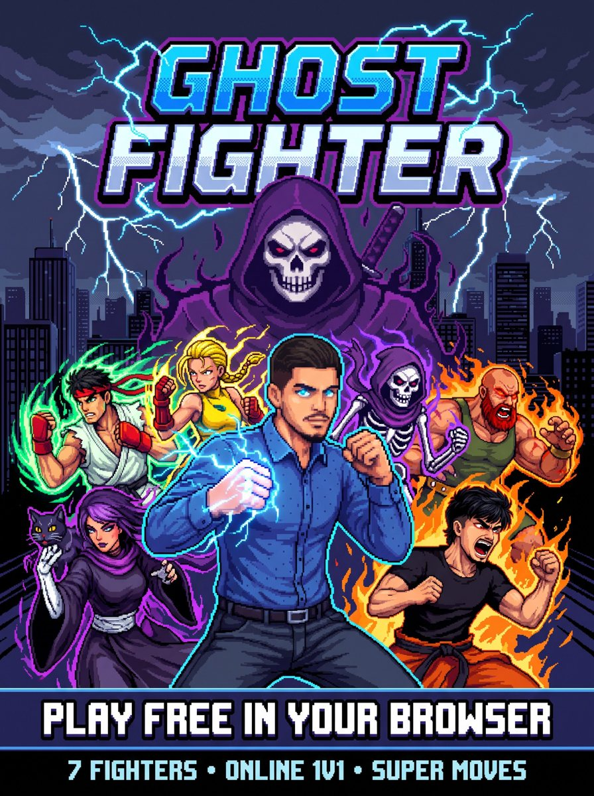

<div align="center">

# 👻 GHOST FIGHTER

**A retro 16-bit arcade fighting game that runs entirely in the browser.**

### [▶ PLAY THE DEMO — ghost.jaxxy.dev](https://ghost.jaxxy.dev/)



*Made by **Jaxxy***

</div>

---

## About

Ghost Fighter is a love letter to the early-90s arcade fighters: chunky pixel art, cut-in super moves, a booming announcer and best-of-three rounds. No installs, no frameworks, no build step: plain HTML, CSS and JavaScript on a `<canvas>`, playable on desktop and on phones.

All the character art, stages, music, sound effects and voice lines were generated with AI from real photos, then cut into animation frames for the game.

## Features

- 🥋 **7 fighters**, each with 20+ animation frames, an energy blast, an uppercut and air attacks
- 👊 **4-hit chain combos**: every press of punch or kick throws a *different* move, and you can mix them
- 💥 **Cinematic ultimates** with anime-style cut-ins, filled by a SUPER meter
- 🌐 **Online 1v1 with room codes**: peer-to-peer (WebRTC) lockstep netcode, rematches, invite links
- 🕹 **Arcade mode** with a boss fight and ending, plus **Versus CPU** with 3 difficulty levels
- 📱 **Mobile ready**: PSP-style on-screen joystick and buttons, rotate-your-phone prompt, installable as a home-screen app
- 🎮 Keyboard, gamepad and touch controls
- 📺 Optional CRT scanline filter

## The roster

| Fighter | Style | Ultimate |
|---|---|---|
| **GHOST** | The street legend | **Phantom Cannon**: a screen-wide energy beam |
| **KAZE** | Karate master | **Tempest Dragon**: a whirlwind beam |
| **VOLTA** | Lightning kickboxer | **Thunder Storm**: lightning dash into a 9-hit combo |
| **BRUTUS** | Iron-bear wrestler | **Iron Meteor**: a leaping ground slam with a shockwave |
| **RYONA** | Agile street-cat claws and capoeira kicks | **Lutchi Claw**: summons her giant cat to maul the opponent |
| **JAXXY** | Heavy brawler-wrestler | **Tyrant's Call**: summons Khufra (Tyrant's Revenge → Tyrant's Rage → Bouncing Ball) |
| **SHADE** | The ghost of the rooftops (boss) | **Soul Reaper**: a beam of ghost skulls |

## Controls

| Action | Keyboard | Touch | Gamepad |
|---|---|---|---|
| Move / block | ← → (hold back to block) | Joystick | D-pad / stick |
| Jump / crouch | ↑ / ↓ or Space | Joystick or △ | D-pad / Y |
| Punch | J or Z | □ | X |
| Kick | K or X | ✕ | A |
| Energy blast | L or C | ○ | B |
| Uppercut | ↓ + Punch | Down + □ | Down + X |
| Ultimate (meter full) | I or V | SUPER | RB / RT |
| Pause | Enter / Esc | ❚❚ | Start |

Tap punch or kick up to 4 times for a combo.

> **iPhone tip:** Safari can't go fullscreen on websites. Tap **Share → Add to Home Screen** and launch the game from its icon to play fullscreen.

## Run it locally

No build step. Serve the folder with any static web server:

```bash
python -m http.server 8080
```

Then open <http://localhost:8080>. Opening `index.html` directly from disk may block the font and audio, so use a server.

## Project structure

```
index.html            page + touch controls overlay
css/style.css         layout, touch controls, CRT filter
js/game.js            engine, fighters, AI, menus, fights, ultimates
js/input.js           keyboard / gamepad / touch joystick
js/audio.js           sound effects (WebAudio) + streamed music
js/net.js             online rooms (PeerJS / WebRTC)
js/meta.js            sprite sizes and anchor points
assets/sprites/       per-fighter animation frames (transparent PNG)
assets/bg/            stages and title art
assets/cutin/         ultimate cut-in banners
assets/audio/         music, sound effects, announcer and voice lines
tools/slice_sheet.py  cuts AI-generated sprite sheets into frames
```

## How the art was made

Each fighter started as a single AI-generated sprite sheet: the person's photo, plus Ghost's sheet as a style guide, prompted with a 4×3 grid of fighting poses on a solid magenta background (Nano Banana Pro / `gemini-3-pro-image`). [`tools/slice_sheet.py`](tools/slice_sheet.py) removes the magenta, finds each pose and exports it as a transparent frame with its anchor point. Music, sound effects and voices were generated with ElevenLabs models.

## Credits

- **Created by Jaxxy**
- Pixel font: [Press Start 2P](https://fonts.google.com/specimen/Press+Start+2P) by CodeMan38 (SIL Open Font License)
- Online play: [PeerJS](https://peerjs.com/) (MIT)
- Khufra is a character from *Mobile Legends: Bang Bang* © Moonton. He appears here as non-commercial fan art.
